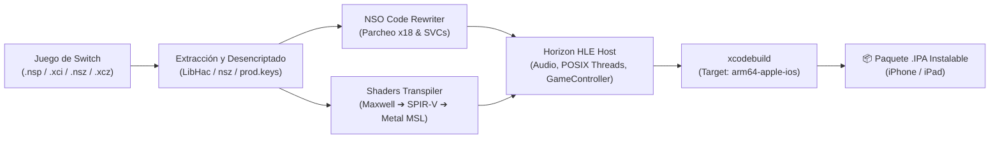

<div align="center">

# 🎮 NSWPORTIOS
### Universal Nintendo Switch to iOS (.IPA) Native Porter & Compiler

[](LICENSE)
[](https://apple.com)
[-orange.svg)]()
[]()
[]()

**NSWPORTIOS** es una suite gráfica y de línea de comandos para recompilar y portear juegos de **Nintendo Switch** directamente a **iOS / iPadOS (.IPA)** y **macOS (.app)** de forma nativa, sin emulación pesada y sin requerir JIT.

---

### 🌐 Redes Sociales del Desarrollador
Desarrollado y mantenido por **thebusk2**:
- 🐙 **GitHub:** [@thebusk2](https://github.com/thebusk2)
- 📸 **Instagram:** [@thebusk2](https://www.instagram.com/thebusk2/)
- 🐦 **X (Twitter):** [@thebusk2](https://x.com/thebusk2)

---

### 📥 Descargas Directas / Instaladores
| Plataforma | Paquete Instalador | Descripción |
| :--- | :--- | :--- |
| 🍏 **macOS** | [**`NSWPORTIOS_macOS.dmg`**](releases/NSWPORTIOS_macOS.dmg) | Imagen de disco con `NSWPORTIOS.app` (arrastrar y soltar a `/Applications`) |
| 🪟 **Windows** | [**`NSWPORTIOS_Windows.zip`**](releases/NSWPORTIOS_Windows.zip) | Paquete ZIP portable con scripts de instalación y acceso directo |

---

</div>

## 🌟 Características Principales

- 🚀 **Ejecución Nativa ARM64:** El código del juego se ejecuta directamente en la CPU de Apple Silicon (M1-M4, A17 Pro+), sin capas de emulación dinámica ni JIT.
- 🎨 **Interfaz Visual Nintendo Switch:** Aplicación de escritorio para macOS (`NSWPORTIOS.app`) y multiplataforma con estética inspirada en los Joy-Cons azul y rojo neón.
- 🌍 **Soporte Multilingüe en Tiempo Real:** Interfaz traducida a 5 idiomas:
  - 🇪🇸 **Español**
  - 🇺🇸 **English**
  - 🇫🇷 **Français**
  - 🇯🇵 **日本語**
  - 🇷🇺 **Русский**
- 📦 **Compatibilidad Universal de Formatos:** Admite `.nsp`, `.xci`, `.nsz` y `.xcz` con detección automática de Updates y DLCs.
- 🎮 **Soporte para Mandos Físicos de iOS:**
  - Pro Controller de Nintendo Switch (con giroscopio y vibración)
  - Joy-Cons oficiales por Bluetooth
  - PlayStation DualSense (PS5) y DualShock 4 (PS4) con hápticos
  - Mandos Xbox Wireless / Series X/S
  - Mandos telescópicos MFi / USB-C (Backbone One, Razer Kishi)
  - Multijugador local en el mismo dispositivo (hasta 8 mandos)
  - Ocultación automática de botones táctiles al conectar un mando físico
- ⚡ **Gráficos Acelerados por Metal 3.0:** Los shaders NVN/Maxwell se transpilan a Metal Shading Language (MSL) antes de jugar (AOT) para evitar el molesto *shader stuttering*.

---

## 🏗️ Arquitectura del Sistema



---

## 📥 Instalación

### En macOS:
1. **Opción 1: Imagen de Disco DMG (Recomendada):**
   * Descarga y abre `NSWPORTIOS_macOS.dmg`.
   * Arrastra `NSWPORTIOS.app` a la carpeta `/Applications`.
2. **Opción 2: Instalador con un Clic:**
   * Haz doble clic en `Install_Mac.command` o ejecuta en la terminal:
     ```bash
     ./setup.sh
     ```

### En Windows:
1. Asegúrate de tener instalado [Python 3.10+](https://www.python.org/downloads/) (con la casilla *"Add Python to PATH"* marcada).
2. Haz doble clic en `install_windows.bat` o ejecuta en PowerShell:
   ```powershell
   .\install_windows.ps1
   ```
3. Se creará un acceso directo en tu Escritorio para abrir la interfaz gráfica.

---

## 🕹️ Modo de Uso (Totalmente por Clics y Botones)

1. Abre **`NSWPORTIOS.app`** (o `python switch2ipa_gui.py`).
2. **Juego:** Pulsa el botón **"Examinar..."** y selecciona tu archivo (`.nsp`, `.xci`, `.nsz`, `.xcz`), o suéltalo en la carpeta `input/`.
3. **Keys:** Si la app indica que no detecta tus llaves, pulsa **"Cargar Keys"** y selecciona tu archivo `prod.keys`.
4. **Ajustes:** Selecciona el idioma del juego, la plataforma (iPhone/iPad o Mac) y si deseas ver el contador de FPS.
5. **Compilar:** Haz clic en **"🚀 COMPILAR A .IPA DE iOS"**.
6. **Instalar:** Una vez finalizado, pulsa **"Abrir Output"** para recoger tu `.ipa` e instalarlo en tu iPhone/iPad con **TrollStore**, **AltStore**, **SideStore** o **Sideloadly**.

---

## 💻 Uso desde Línea de Comandos (CLI)

```bash
# Compilar juego colocado en input/ con prod.keys de keys/
./switch2ipa

# Compilar un archivo específico con opciones personalizadas
./switch2ipa -i "/ruta/al/juego.nsp" -k "/ruta/prod.keys" -l es --fps

# Para juegos gigantes (>15 GB) con RomFS separado para transferencia rápida por USB
./switch2ipa -i "/ruta/al/juego.xci" --romfs separate

# Compilar para macOS como aplicación ejecutable
./switch2ipa -i "/ruta/al/juego.nsp" --platform mac-app
```

---

## ❤️ Créditos y Proyectos de Referencia

Este proyecto integra y se basa en las investigaciones y desarrollos de la comunidad de ingeniería inversa y homebrew de Nintendo Switch:

* **[seedds / nxnative](https://github.com/seedds/nxnative):** Núcleo original del reescritor de NSO, host HLE de Horizon y backend NVN-a-Metal.
* **[Thealexbarney / LibHac](https://github.com/Thealexbarney/LibHac):** Biblioteca en C# para el parseo, desencriptado y manejo de sistemas de archivos de Nintendo Switch (NSP, XCI, RomFS, NCAs).
* **[jhaizhou-ops / d2r-mobile](https://github.com/jhaizhou-ops/d2r-mobile):** Proyecto pionero de ejecución nativa de juegos de Switch en dispositivos móviles con aceleración Metal/Vulkan.
* **[Ryujinx Project](https://github.com/Ryujinx/Ryujinx):** Transpilador de shaders NVIDIA Maxwell a SPIR-V.
* **[Atmosphère-NX](https://github.com/Atmosphere-NX/Atmosphere):** Mesosphère kernel y semántica de sincronización del sistema Horizon.
* **[switchbrew / switch-tools](https://github.com/switchbrew/switch-tools):** Herramientas de bajo nivel para manipulación de binarios y metadatos de Nintendo Switch.
* **[Nico Bosshard / nsz](https://github.com/nicoboss/nsz):** Algoritmo de compresión y descompresión de bloques zstd para archivos NSZ y XCZ.

---

## ⚖️ Licencia

Distribuido bajo la Licencia **MIT**. Consulta el archivo [LICENSE](LICENSE) para más información.
